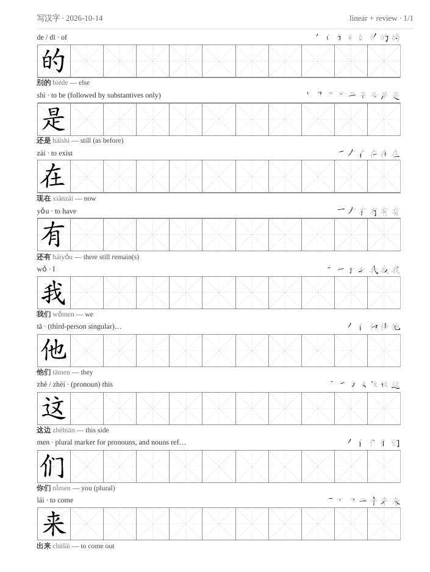
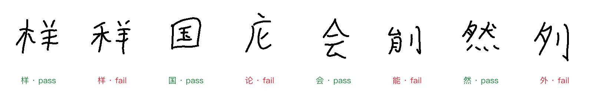

# xiehanzi — 写汉字

Daily Chinese handwriting sheets for the Supernote e-ink tablet that grade themselves from
your pen strokes.



*A sheet as a fresh clone generates it: 米字格 practice rows, the model character in the
first cell, a 笔顺 stroke-order filmstrip above each row, and an HSK example word below.*

## The premise

**Anki measures recognition. This measures production.** An HSK 1–3 deck can be almost
entirely mature while most of its characters still can't be written from memory. So
writing ability gets its own state and its own schedule, and is never inferred from Anki
intervals.

## The daily loop

1. **Morning.** A scheduled job first grades any written-on sheet that has synced back
   since last night, so today's plan reflects it.
2. **Carry or generate.** If the last sheet came back with no ink, it is *carried*:
   renamed to today on the cloud, locally and in the manifest, so the device never holds
   two blank sheets. Otherwise a new sheet is planned:
   - characters pinned with `add` come first;
   - review vocabulary from Anki, if asked for with `--review=N` (off by default);
   - then **linear** catch-up through the HSK 3.0 character list, band by band, fills the
     rest (nine characters a day by default);
   - recall rows for whatever is due are prepended.
3. **Push.** The sheet is a real Supernote `.note` notebook, uploaded to Supernote Cloud.
4. **Sync.** The device pulls it down like any other notebook.
5. **Write.** You open it and write in it natively, with no PDF import and no annotation
   layer.
6. **Evening.** A second job pulls the written-on notebook back and grades the recall
   rows from the pen strokes stored in the file.
7. **Schedule.** Each verdict updates an SM-2 recall schedule: 1 day, then 3 days, then
   `interval × ease`.

Recall is bounded by the standard. HSK 3.0 lists 3,000 characters to recognise but only
1,200 (the 手写字表) to write by hand. A character becomes eligible for recall only once
it has been drilled **and** is on that list, so the system never asks you to write a
character the standard only expects you to read.

## Recall, graded from ink

Copying is not recall: a character drilled ten times yesterday can still be gone today.
Due characters appear as gap-fill rows (`城＿ chéngshì — city`), followed by a solutions
page, then the drill rows. **Only the first cell of a recall row is graded.** The rest of
the row is for writing the correction after checking the answer.

Grading reads the strokes, not the pixels:

- **Google's handwriting recogniser** (the engine behind Gboard) reads the strokes of the
  graded cell.
- **A stroke-count gate** fails any pass whose stroke count is more than one off the
  reference. This catches the malformed characters a recogniser snaps to the nearest real
  one.
- **The confusion rule.** Writing 作 when 做 was asked fails 做. If 作 is itself a
  character you are learning, and a second witness (its stroke count, or the vision
  partner) agrees it is what was written, 作 fails too: writing the wrong character shows
  that one isn't reliably recalled either.
- **Nothing is self-reported.** Grading a date twice changes nothing. A sheet with no ink
  records nothing, so an unopened morning carries items forward instead of failing every
  row. A recogniser outage marks the day *degraded* and it is re-graded on a later night.
- **Relearning.** A character that lapses twice goes back onto a drill sheet to be
  retaught, then re-enters recall.



*Real handwriting from the evaluation set: recall cells written from memory on the device,
labelled by hand as the character asked plus pass or fail. The two 样 show why the stroke
gate exists: the failed one is written with 禾 instead of 木, and a recogniser happily reads
it as 样. The shipped grader is scored against these labels and gets 5 of the 126 wrong.*

## Engineering highlights

- **A reverse-engineered file format.** Supernote's `.note` format is undocumented. The
  writer and reader (`src/deliver/note/`) were built by dissecting notes the device made.
  Two lessons are recorded in the code:
  - `PAGESTYLE` is not a label. The device resolves it against its own template store,
    and a custom name leaves the note hanging on "loading", unopenable. Pages name a
    built-in style, and the sheet is drawn as ordinary ink in `LAYER1`.
  - Two independent parsers accepting a generated file does not mean the device will,
    because the firmware acts on fields the parsers ignore.
- **Strokes from `TOTALPATH`.** Each page's `TOTALPATH` block holds every pen stroke in
  the order and direction it was written (`src/deliver/note/strokes.ts`). That makes
  *online* handwriting recognition possible, which reads the pen's trajectory and is far
  more accurate for Chinese than reading a picture. On a 101-cell labelled benchmark, the
  device's own transcription made 27 errors and Google's recogniser alone made 6. The
  shipped pipeline makes 5 errors over the full 126-cell evaluation set. A vision model
  run as a second opinion did better on the benchmark but vetoed correct answers on real
  history, so it is off by default. The 126 cells are committed under `eval/recognition/`
  as strokes, PNGs and labels.
- **Idempotent everywhere.** The morning job runs with nobody watching, so every step can
  be retried safely:
  - notes are byte-reproducible from the sheet name;
  - re-running `generate` for a date reproduces that sheet, recall rows included, rather
    than planning a new one;
  - `push` compares md5 checksums and does nothing when the file is already there;
  - replacing a remote file refuses if the notebook has been written on since;
  - grading twice is a no-op.
- **Glyphs from stroke data, not a font.** The model character and the stroke-order
  filmstrip are SVG paths from `hanzi-writer-data`, so they are guaranteed to be the same
  shape. The stroke counts the grader checks against come from the same data.
- **A pure schedule.** SM-2 is replayed from an append-only review log rather than stored,
  so it can never drift from the evidence. A re-grade appends a higher revision instead of
  editing history.

The reasoning behind these calls is in [docs/decisions.md](docs/decisions.md). The full
designs are [the original design](docs/superpowers/specs/2026-08-19-xiehanzi-design.md),
[the recall system](docs/superpowers/specs/2026-08-21-recall-system-design.md) and
[stroke-recognition grading](docs/superpowers/specs/2026-10-01-stroke-recognition-grading-design.md).

## Setup

### Try it without a Supernote

Requires Node 22 or later.

```bash
npm ci
npx playwright install chromium   # on Linux: npx playwright install --with-deps chromium
npm run build
node dist/cli.js generate --format=pdf
```

The sheet lands in `out/`. Running `node dist/cli.js --help` lists every command. Without
Anki, a sheet simply walks the HSK 3.0 list.

The practice glyphs are drawn from stroke data. The surrounding Chinese text (header,
example words) uses the CSS font chain `"LXGW WenKai", "Kaiti SC", "STKaiti", serif`.
macOS ships Kaiti. On Debian or Ubuntu, `--with-deps` pulls in a CJK font, and installing
`fonts-noto-cjk` or LXGW WenKai gives a closer match.

### Supernote (the real thing)

The page geometry targets the **Supernote Manta** (1920×2560).

1. Copy `.env.example` to `.env` and fill in `SUPERNOTE_EMAIL` and `SUPERNOTE_PASSWORD`.
2. Run `node dist/cli.js login`. If the account asks for a verification code, it is
   emailed to you and you type it in. The session token is saved to
   `.supernote-session.json` so later pushes run unattended. That file holds no password,
   and both it and `.env` are gitignored.
3. Run `node dist/cli.js generate` (a `.note` by default), then `node dist/cli.js push`.
   Sheets go to `Note/中文/写汉字` on the cloud, as set in `config/delivery.json`.
4. To make it daily, schedule `bin/morning.sh` (06:20, say) and `bin/grade.sh`
   in the evening, with cron or launchd. The morning script grades, carries or generates,
   and pushes. The evening script grades the last seven days.

The scripts are written for macOS: they use BSD `date -v`, `perl` and a Homebrew `PATH`.
`state/` is your learning history, so the shipped `.gitignore` ignores it. Both scripts
pull before they run when the checkout has a git remote, and they commit and push `state/`
only when git tracks it, so out of the box it stays on this machine. To sync it between
machines through git, clone into a **new private repository** (not a GitHub fork: a fork of
a public repository is public) and delete the `/state/` line from `.gitignore` there. Don't
force-add past the ignore rule with `git add -f`. Once the first run has created `state/`,
run `git add state/` and commit once; from then on the scripts commit and push it after
every run.

The session token eventually expires, and nobody documents when. Pushes then fail and the
script exits non-zero, so your scheduler can alert you. The fix is to run `login` again.
It needs the emailed code, so it can't be automated.

### Recall grading

```bash
node dist/cli.js grade --date=2026-10-14       # pull that day's sheet back and grade it
node dist/cli.js carry --dry-run               # would today get a new sheet, or carry?
node dist/cli.js regrade --from=2026-10-01 --dry-run   # what re-grading would change
```

`config/recognition.json` holds the recogniser settings:

- `maxStrokeDelta` sets the stroke gate (default 1).
- `partnerMode` controls when a vision model on OpenCode Go is asked for a second
  opinion: `off`, `ambiguous` or `always`. The default is `off`.
- A partner needs `XIEHANZI_OPENCODE_GO_KEY` in `.env`.

`npm run eval:recognition` re-scores the recognisers on the 126 labelled cells. It needs
that key and network access, and makes one Google call and one partner call per cell.

**Privacy note.** Google's handwriting endpoint is undocumented and unauthenticated.
Grading sends it the pen strokes of each graded cell, one character at a time, with no
account, key or other content. If the endpoint changes or disappears, grading degrades rather than
failing.

### Anki (optional)

Anki is used through [AnkiConnect](https://ankiweb.net/shared/info/2055492159).
`config/decks.json` names the decks, note type and fields. It matches the shared "HSK 3.0
Vocabulary" deck layout, so edit it to fit your own collection.

- `generate --review=N` turns on double-down mode. It adds up to N characters from
  yesterday's new cards, your latest class (notes tagged `class` plus the date) and the
  cards with the most lapses.
- `learn 塑料 --pinyin=sùliào --meaning="plastic"` captures a term: it upserts the card,
  reschedules it for today, and queues its characters for the next sheet. Before any write
  it POSTs to a local backup service (`XIEHANZI_ANKI_BACKUP_URL`, default
  `http://127.0.0.1:18766/backup`) and aborts if that fails. With no such service, set
  `XIEHANZI_ANKI_BACKUP=off` to write without a backup; it prints a warning each time.
- `add 惯 父 校 --on=tomorrow` pins characters to a sheet without touching Anki.
- `glossary` refreshes the local definitions file from your deck, so sheets prefer your
  definitions over CC-CEDICT's.

## Development

```bash
npm test            # vitest
npm run typecheck   # tsc --noEmit
```

Every command also takes `--json`, and most take `--dry-run`.

## Data and licence

The repository vendors CC-CEDICT (CC BY-SA 4.0) and the HSK 3.0 character and word lists
(MIT). The stroke data comes from the `hanzi-writer-data` npm package, whose outlines
derive from Make Me a Hanzi and Arphic's AR PL UKai. Sources and licences are in
[data/README.md](data/README.md).

xiehanzi is licensed under the GNU Affero General Public License v3.0 only
(`AGPL-3.0-only`); see [LICENSE](LICENSE).

Copyright © 2026 Franco Gómez Schumacher.
